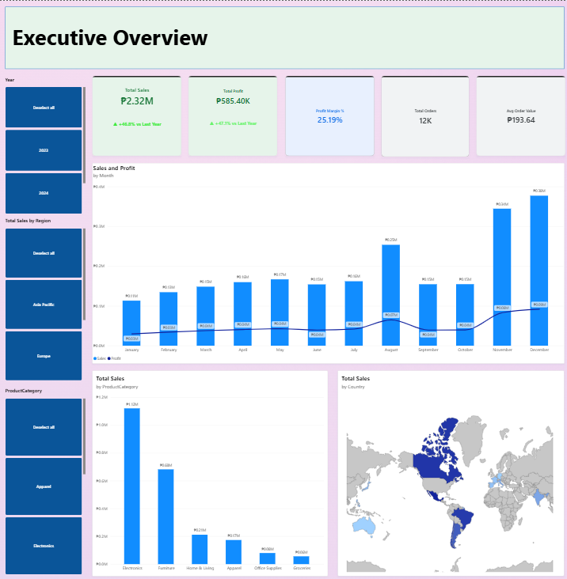
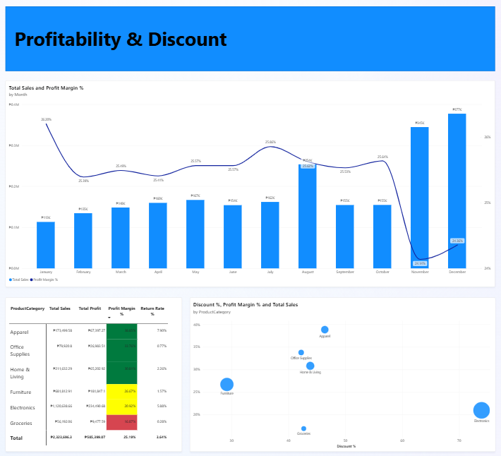
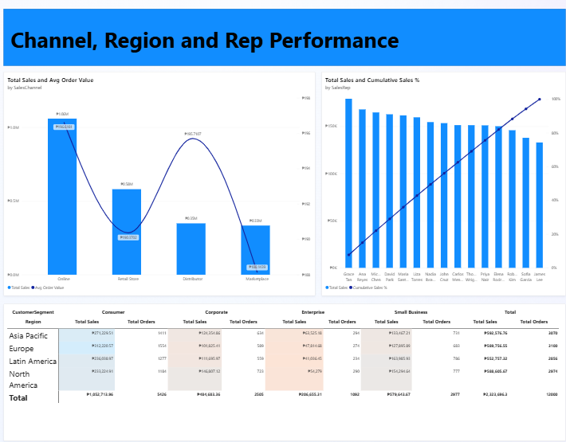
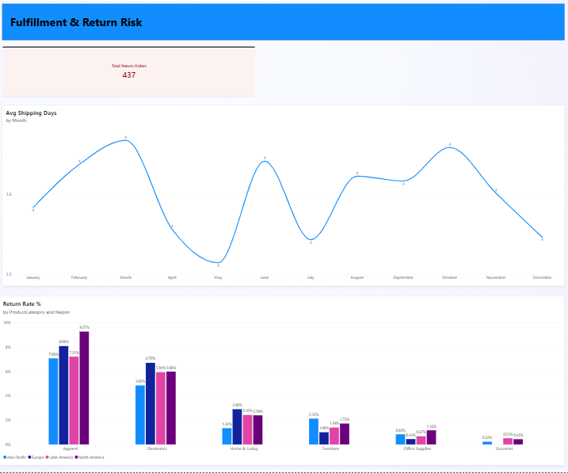

# Sales Performance Analytics Dashboard

An interactive Power BI dashboard analyzing 3 years of transactional sales data to identify where revenue growth is coming at the cost of profit margin, and where product/fulfillment risk is hiding inside otherwise healthy sales numbers.

---

## Table of Contents
- [Sales Performance Analytics Dashboard](#sales-performance-analytics-dashboard)
  - [Table of Contents](#table-of-contents)
  - [Overview](#overview)
  - [Business Problem](#business-problem)
  - [Dataset](#dataset)
  - [Tools \& Skills](#tools--skills)
  - [Dashboard Structure](#dashboard-structure)
  - [Key Insights](#key-insights)
  - [DAX Measures](#dax-measures)
  - [How to Reproduce](#how-to-reproduce)
  - [Screenshots](#screenshots)
    - [1. Executive Overview](#1-executive-overview)
    - [2. Profitability \& Discounts](#2-profitability--discounts)
    - [3. Channel \& Rep Performance](#3-channel--rep-performance)
    - [4. Fulfillment \& Returns](#4-fulfillment--returns)
  - [Author](#author)

---

## Overview

This project turns a 12,000-row transactional sales dataset into a 4-page Power BI dashboard covering revenue, profitability, channel/rep performance, and fulfillment risk. It's built as a portfolio piece to demonstrate end-to-end data analyst work: data modeling, DAX, visual design, and — most importantly — turning charts into a specific business recommendation rather than just reporting numbers.

## Business Problem

> **Where is the company losing revenue and margin, and which regions, products, channels, and reps should leadership focus on to grow profitably next quarter?**

Total revenue alone hides the real story. This dashboard was designed to answer three sharper questions:
1. Is Q4 discounting growing revenue at the expense of profit margin?
2. Which product categories and channels carry disproportionate return or margin risk?
3. Are shipping delays and returns concentrated in specific categories or regions?

## Dataset

`Sales_Dataset.xlsx` — 12,000 order lines, January 2023–December 2025.

| Field | Description |
|---|---|
| OrderID, OrderDate, Year/Quarter/Month | Order identifiers and date parts |
| CustomerID, CustomerName, CustomerSegment | Consumer / Small Business / Corporate / Enterprise |
| Region, Country | 4 regions, multiple countries each |
| ProductCategory, ProductName | 6 categories (Electronics, Office Supplies, Furniture, Apparel, Home & Living, Groceries) |
| Quantity, UnitPrice, Discount | Order line economics |
| SalesAmount, Profit | Net revenue and estimated profit after discount |
| SalesChannel, PaymentMethod | Online, Retail Store, Distributor, Marketplace |
| SalesRep | 15 sales representatives |
| ShippingDays, Returned | Fulfillment and returns tracking |

Full field descriptions are in the `Data_Dictionary` sheet inside the workbook.

## Tools & Skills

Power BI (Power Query, Data Modeling, DAX) · Microsoft Excel · Data Cleaning & Transformation · Dashboard Design · Business Insight Generation

## Dashboard Structure

**1. Executive Overview** — Total Sales, Total Profit, Profit Margin %, Total Orders, and Avg Order Value KPI cards; a dual-axis Sales-vs-Profit trend by month; a sales-by-country map; a sales-by-category bar chart; Year/Region/Category slicers.

**2. Profitability & Discounts** — Category-level table (Sales, Profit, Margin %, Return Rate %) with conditional formatting flagging margin risk; a Discount % vs. Profit Margin % scatter plot sized by sales; a Sales-vs-Margin % trend by month.

**3. Channel & Rep Performance** — Sales vs. Average Order Value by channel; a Pareto chart of sales by rep with cumulative % contribution; a Region × Customer Segment matrix.

**4. Fulfillment & Returns** — Total Returned Orders KPI; Return Rate % by category and region; Average Shipping Days trend by month.

## Key Insights

- **Margin erosion in peak season** — Q4 (Nov/Dec) drives roughly 2x the revenue of an average month, but profit margin % dips over the same period as discounting increases — revenue growth that partly cannibalizes profitability.
- **Category risk concentration** — Electronics and Apparel carry the highest return rates (6–8%) versus under 2% for Office Supplies and Groceries, despite being strong revenue drivers.
- **Uneven rep contribution** — A small subset of sales reps account for a disproportionate share of total revenue, visible in the Pareto chart on the Channel & Rep page.
- **Channel economics differ** — Online has the highest order volume, but Distributor orders carry a meaningfully higher average order value.
- **Fulfillment pressure tracks seasonality** — Average shipping days rise during the same peak months that see the highest order volume, a leading indicator worth monitoring against the return rate.

## DAX Measures

```DAX
Total Sales = SUM(Sales_Data[SalesAmount])
Total Profit = SUM(Sales_Data[Profit])
Profit Margin % = DIVIDE([Total Profit], [Total Sales], 0)
Total Orders = DISTINCTCOUNT(Sales_Data[OrderID])
Avg Order Value = DIVIDE([Total Sales], [Total Orders], 0)
Return Rate % = DIVIDE(
    CALCULATE(DISTINCTCOUNT(Sales_Data[OrderID]), Sales_Data[Returned] = "Yes"),
    [Total Orders], 0
)
Avg Shipping Days = AVERAGE(Sales_Data[ShippingDays])
Sales PY = CALCULATE([Total Sales], SAMEPERIODLASTYEAR(DateTable[Date]))
Sales YoY % = DIVIDE([Total Sales] - [Sales PY], [Sales PY], 0)
```

Conditional formatting rule on Profit Margin % (Profitability & Discounts page):
- 🔴 Red — below 20%
- 🟡 Yellow — 20%–30%
- 🟢 Green — above 30%

## How to Reproduce

1. Clone this repo and open `Sales_Dataset.xlsx` in Power BI Desktop (`Get Data → Excel Workbook`).
2. Build a Date table and relate it to `OrderDate` (see DAX above).
3. Add the DAX measures listed above.
4. Recreate the four report pages per the [Dashboard Structure](#dashboard-structure) section.
5. Open `pr.pbix` directly if you just want the finished report.

## Screenshots

### 1. Executive Overview



### 2. Profitability & Discounts



### 3. Channel & Rep Performance



### 4. Fulfillment & Returns




## Author

**Lord Natan Galicia**
BSIT, Dr. Yanga's Colleges, Inc. | Data Analyst
[LinkedIn](https://linkedin.com/in/natan-galicia) · natangalicia515@gmail.com
